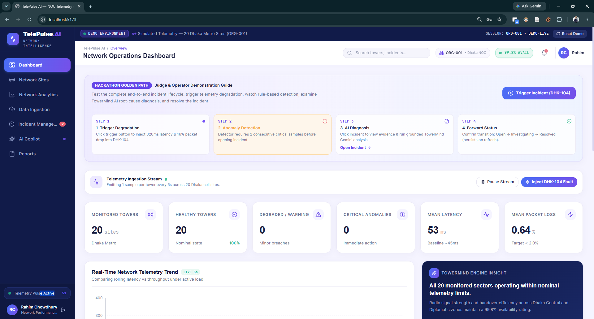

# 📡 TelePulse AI — NOC Telemetry & Intelligent Incident Diagnosis

[](https://react.dev/)
[](https://www.typescriptlang.org/)
[](https://vitejs.dev/)
[](https://tailwindcss.com/)
[](https://ai.google.dev/)
[](https://firebase.google.com/)
[](https://vitest.dev/)
[](https://gdg.community.dev/)

> 🏆 **BUILD WITH AI Google Developer Hackathon 2026 Project**  
> Developed for the **BUILD WITH AI Google Developer Hackathon 2026**, organized by **GDG Sonargaon** in collaboration with the **Department of Computer Science, East West University**.

> **Monitor. Detect. Diagnose. Decide.**  
> TelePulse AI is an enterprise-grade Network Operations Center (NOC) platform that bridges real-time cellular tower telemetry monitoring with Gemini-powered root-cause diagnosis, accelerating telecom incident resolution from hours to seconds.

---

## 📑 Table of Contents

- [Overview](#-overview)
- [Key Features](#-key-features)
- [Architecture & Data Flow](#-architecture--data-flow)
- [Tech Stack](#-tech-stack)
- [Quick Start](#-quick-start)
- [Environment Configuration](#-environment-configuration)
- [Golden Path Demo Walkthrough](#-golden-path-demo-walkthrough)
- [Project Structure](#-project-structure)
- [Testing & Quality Assurance](#-testing--quality-assurance)
- [Security & Firestore Rules](#-security--firestore-rules)
- [Documentation Index](#-documentation-index)
- [Hackathon & Acknowledgments](#-hackathon--acknowledgments)
- [License](#-license)

---

## 🔭 Overview

In modern telecom networks, NOC engineers face a constant deluge of metric fluctuations, alerts, and alarm fatigue. When multiple towers degrade simultaneously, determining whether an issue is caused by physical fiber cuts, hardware power degradation, software config drift, or localized cell congestion takes valuable time.

**TelePulse AI** solves this by:
1. **Continuous Telemetry Monitoring:** Ingesting multi-metric cellular data (latency, packet loss, jitter, signal strength dBm, traffic, availability).
2. **Deterministic Anomaly Detection:** Pure, rule-based anomaly detection algorithms that eliminate false alarms by requiring consecutive sample violations before triggering incidents.
3. **Gemini Root-Cause Analysis (RCA):** Leveraging Google Gemini to analyze strict, privacy-safe allowlisted telemetry data and output actionable hypotheses, diagnostic checks, and recommended remediations.
4. **Deterministic Fallback Engine:** Graceful degradation to built-in rule heuristics if API quotas or network disruptions occur.
5. **Real-time Incident Lifecycle:** Seamless state synchronization across NOC teams via Cloud Firestore.

---

## Preview




## 🌟 Key Features

### 1. Real-Time NOC Dashboard & Tower Health
- Dynamic tower health grid displaying active cellular sites across Dhaka North, South, Gulshan, and Motijheel sectors.
- Live metric visualizers for latency, packet loss, signal dBm, and traffic throughput using **Recharts**.
- One-click incident simulation (e.g., simulating severe packet loss and fiber degradation on Tower `DHK-104`).

### 2. Gemini-Powered Incident Copilot & Diagnosis
- Deep incident investigations powered by `gemini-flash-lite-latest`.
- Structured JSON outputs strictly validated with JSON Schema:
  - **Executive Summary:** Plain-language incident description.
  - **Ranked Hypotheses:** Confidence-weighted potential root causes.
  - **Diagnostic Checklist:** Ordered physical and logical verification steps for field technicians.
  - **Remediation Plan:** Immediate recovery actions and long-term mitigations.
- Strict data sanitization via an **Allowlist Engine** ensuring no PII, credentials, or untrusted payload fields reach the AI model.

### 3. Incident Lifecycle Management
- Full state workflow: `NEW` ➔ `INVESTIGATING` ➔ `MITIGATING` ➔ `RESOLVED` / `DISMISSED`.
- Resolution notes, owner assignments, and timeline event audit trails.
- Real-time persistence via Firebase Firestore with offline-first support.

### 4. Telemetry Ingestion & Batch Testing
- Upload JSON/CSV historical or simulated telemetry files.
- Real-time schema validation rejecting malformed, negative, or malicious telemetry inputs.
- Synthetic network load simulator with configurable intervals (1s to 10s).

### 5. NOC Executive Reports & Analytics
- Network SLA compliance calculations and MTTR (Mean Time to Resolution) tracking.
- Severity distribution breakdowns (Critical, Major, Minor, Info).
- Exportable shift handoff summaries for telecom operations.

---

## 🏗 Architecture & Data Flow

```
┌────────────────────────────────────────────────────────────────────────┐
│                          TELEPULSE AI (BROWSER)                        │
├────────────────────────────┬─────────────────────────────┬─────────────┤
│     Telemetry Engine       │       Anomaly Engine        │  NOC Store  │
│  • Synthetic Simulator     │  • Metric Threshold Rules   │  • State    │
│  • CSV/JSON Ingestion      │  • Consecutive Sample Check │  • React 19 │
│  • Schema Sanitizer        │  • Incident Factory         │  • Context  │
└─────────────┬──────────────┴──────────────┬──────────────┴──────┬──────┘
              │                             │                     │
              ▼                             ▼                     ▼
┌──────────────────────────┐  ┌──────────────────────────┐  ┌─────────────┐
│    Allowlist Filter      │  │     Cloud Firestore      │  │ Local Cache │
│  • Strips raw / PII      │  │  • Incidents Collection  │  │ & Fallback  │
│  • Packages safe context │  │  • Audit Timeline Logs   │  └─────────────┘
└─────────────┬────────────┘  └──────────────────────────┘
              │
              ▼
┌──────────────────────────┐
│   Google Gemini API      │
│  • Root Cause Hypotheses │
│  • Diagnostic Checklist  │
│  • Remediation Actions   │
└──────────────────────────┘
```

---

## 💻 Tech Stack

- **Framework:** [React 19](https://react.dev/) + [Vite 6](https://vitejs.dev/)
- **Language:** [TypeScript 5.7](https://www.typescriptlang.org/)
- **Styling:** [Tailwind CSS 3.4](https://tailwindcss.com/) + PostCSS
- **AI Engine:** Google Gemini Developer API (`@google/genai`)
- **Backend / Database:** [Firebase Firestore](https://firebase.google.com/docs/firestore) + [Firebase Hosting](https://firebase.google.com/docs/hosting)
- **Icons & Visualization:** [Lucide React](https://lucide.dev/), [Recharts](https://recharts.org/)
- **Testing:** [Vitest 3](https://vitest.dev/)

---

## 🚀 Quick Start

### Prerequisites
- [Node.js](https://nodejs.org/) (v18.0.0 or higher)
- npm (v9.0.0 or higher)
- A Google Gemini API Key ([Google AI Studio](https://aistudio.google.com/))
- *(Optional)* A Firebase Project for live multi-user Firestore persistence

### Installation

1. **Clone the repository:**
   ```bash
   git clone https://github.com/your-username/telepulse-ai.git
   cd telepulse-ai
   ```

2. **Install dependencies:**
   ```bash
   npm install
   ```

3. **Configure environment variables:**
   ```bash
   cp .env.example .env
   ```
   Open `.env` and add your Gemini API key:
   ```env
   VITE_GEMINI_API_KEY="your_actual_gemini_api_key_here"
   VITE_GEMINI_MODEL=gemini-flash-lite-latest
   ```

4. **Start the local development server:**
   ```bash
   npm run dev
   ```
   Open [http://localhost:5173](http://localhost:5173) in your browser.

5. **Run tests:**
   ```bash
   npm test
   ```

6. **Build for production:**
   ```bash
   npm run build
   ```

---

## ⚙️ Environment Configuration

| Variable | Required | Description | Default |
| :--- | :---: | :--- | :--- |
| `VITE_GEMINI_API_KEY` | **Yes** (or mock mode) | Google Gemini API key from AI Studio | `""` |
| `VITE_GEMINI_MODEL` | No | Gemini model variant | `gemini-flash-lite-latest` |
| `VITE_FIREBASE_API_KEY` | Optional | Firebase Web API Key | `""` |
| `VITE_FIREBASE_PROJECT_ID` | Optional | Firebase Project ID | `""` |
| `VITE_FIREBASE_AUTH_DOMAIN` | Optional | Firebase Auth Domain | `""` |
| `VITE_FIREBASE_STORAGE_BUCKET`| Optional | Firebase Storage Bucket | `""` |
| `VITE_FIREBASE_MESSAGING_SENDER_ID` | Optional | Firebase Sender ID | `""` |
| `VITE_FIREBASE_APP_ID` | Optional | Firebase App ID | `""` |
| `VITE_DEMO_ORG_ID` | No | Tenant/organization scope identifier | `ORG-001` |
| `VITE_SIM_INTERVAL_MS` | No | Background telemetry tick frequency | `5000` |

> ℹ️ *Note: TelePulse AI is designed to run seamlessly out of the box even without Firebase configured. If Firebase keys are omitted, it operates in in-memory session mode.*

---

## 🎯 Golden Path Demo Walkthrough

Judges and evaluators can easily verify the end-to-end functionality in **under 2 minutes**:

1. **Access the NOC Portal:**
   - Launch `http://localhost:5173` and click **"1-Click Fast-Track Demo Access"**.
2. **Observe Steady-State Telemetry:**
   - Notice live streaming telemetry ticks across towers `DHK-101`, `DHK-102`, `DHK-103`, and `DHK-104`.
3. **Trigger Fiber Degradation Scenario:**
   - In the **Try-It Guide Card**, click **"Trigger Incident (DHK-104)"**.
   - Watch `DHK-104` metrics spike: Latency jumps to > 280ms, Packet Loss > 12%.
4. **Autonomous Anomaly Detection:**
   - After 2 consecutive anomalous cycles (~6s), the rule detector flags an alert and automatically creates incident **`INC-...`** with **CRITICAL** severity.
5. **Inspect & Run Gemini AI Diagnosis:**
   - Click the incident in the **Recent Incidents Feed**.
   - Click **"⚡ Analyze with Gemini"**.
   - In seconds, Gemini delivers ranked root-cause hypotheses (e.g. *Optical Fiber Attenuation / SFP Module Degradation*), a field technician checklist, and immediate mitigations.
6. **Execute State Workflow:**
   - Transition incident status: `New` ➔ `Investigating` ➔ `Mitigating` ➔ `Resolved`.
   - Add operator resolution notes. The status update persists immediately across page refreshes.

---

## 📁 Project Structure

```
d:\Hackathon\
├── docs/                        # Complete design & specification documents
│   ├── Accessibility.md         # A11y guidelines & WCAG compliance
│   ├── AGENTS.md                # Multi-agent coordination protocols
│   ├── AI_Test_Cases.md         # AI validation test cases & scenarios
│   ├── API_Spec.md              # REST/AI schemas & JSON definitions
│   ├── AppFlow.md               # User journeys & routing architecture
│   ├── Demo_Script.md           # 2-minute judging demo runbook
│   ├── HANDOVER.md              # Engineering phase completion checklist
│   ├── Judge_Mode.md            # Hackathon judging rubrics & guidelines
│   ├── Plan.md                  # Implementation roadmap
│   ├── PRD.md                   # Product Requirements Document
│   ├── Risks.md                 # Risk matrix & mitigation plans
│   ├── Schema.md                # Data schemas & Firestore specifications
│   ├── Testing.md               # Quality assurance & verification plan
│   ├── TRD.md                   # Technical Requirements Document
│   └── UI_Spec.md               # Design tokens, layouts & components
├── public/                      # Static assets & favicon
│   └── vite.svg
├── src/
│   ├── components/              # Modular UI components
│   │   ├── common/              # Reusable badges, cards, dialogs, banners
│   │   ├── dashboard/           # Feed, tower grid, try-it guide
│   │   ├── incidents/           # Incident detail modal & analysis views
│   │   ├── layout/              # Sidebar, top navigation, app frame
│   │   └── sites/               # Tower drawer & detailed site telemetry
│   ├── config/                  # App constants & operational thresholds
│   ├── context/                 # AuthContext & NetworkContext
│   ├── domain/                  # Pure TypeScript business & detection logic
│   │   ├── __tests__/           # Vitest end-to-end and unit test suites
│   │   ├── aiValidation.ts      # Schema validator & Gemini fallback engine
│   │   ├── allowlist.ts         # Strict sanitization & privacy filter
│   │   ├── analytics.ts         # Baseline calculations & health scoring
│   │   ├── detector.ts          # Pure-logic consecutive anomaly detector
│   │   ├── incidentFactory.ts   # Incident creation & state machine
│   │   ├── reportStats.ts       # SLA, MTTR, and incident aggregations
│   │   ├── types.ts             # Shared domain TypeScript interfaces
│   │   ├── uploadParser.ts      # Telemetry CSV/JSON parsing engine
│   │   └── validation.ts        # Telemetry range & format sanitization
│   ├── pages/                   # Top-level view routes
│   │   ├── AnalyticsPage.jsx    # SLA & metric analytics
│   │   ├── CopilotPage.jsx      # Conversational NOC AI query assistant
│   │   ├── DashboardPage.jsx    # Real-time monitoring overview
│   │   ├── IncidentsPage.jsx    # Filterable incident log & lifecycle
│   │   ├── IngestionPage.jsx    # Telemetry data upload & verification
│   │   ├── LoginPage.jsx        # Operator sign-in & fast-track demo access
│   │   ├── ReportsPage.jsx      # Operations shift handoff reports
│   │   └── SitesPage.jsx        # Tower inventory & coverage maps
│   ├── services/                # External & async service integrations
│   │   ├── apiClient.ts         # Centralized HTTP request layer
│   │   ├── copilotOps.ts        # Operations copilot prompt helpers
│   │   ├── errorMapper.ts       # Standardized user-friendly error handler
│   │   ├── firestore.ts         # Cloud Firestore real-time CRUD service
│   │   ├── gemini.ts            # Gemini Flash Lite SDK integration
│   │   └── simulator.ts         # Synthetic telemetry generator
│   ├── state/                   # Application global state container
│   │   └── TelePulseContext.tsx
│   ├── App.tsx                  # Root application router
│   ├── index.css                # Global Tailwind CSS directives
│   ├── main.tsx                 # React DOM mount point
│   └── vite-env.d.ts            # Vite client type definitions
├── .env.example                 # Environment variables blueprint
├── .gitignore                   # Standard Git ignore file
├── firebase.json                # Firebase Hosting & Firestore deploy config
├── firestore.rules              # Enterprise Firestore Security Rules
├── index.html                   # HTML entry page
├── package.json                 # Project dependencies & scripts
├── postcss.config.js            # PostCSS configuration
├── tailwind.config.js           # Tailwind design tokens & themes
├── tsconfig.json                # TypeScript compiler configuration
└── vite.config.ts               # Vite build & plugin settings
```

---

## 🧪 Testing & Quality Assurance

TelePulse AI comes with an automated **Vitest** test suite verifying domain logic, anomaly detection, data sanitization, and end-to-end incident lifecycles:

```bash
# Run Vitest suite
npm test
```

### Verified Test Matrix:
- `T-01`: End-to-end Golden Path execution (`Simulator` ➔ `Detector` ➔ `Incident` ➔ `Gemini Diagnosis` ➔ `Status Lifecycle`).
- `T-02`: Input validation and unknown field stripping.
- `T-03`: Malicious payload, XSS, and out-of-range telemetry rejection.
- `T-04`: Dynamic baseline computation and health score degradation logic.
- `T-05`: Anomaly detector triggering on 2 consecutive rule violations.
- `T-06`: Incident factory state transitions and valid lifecycle workflows.
- `T-07`: Gemini allowlist data sanitization and output schema validation.
- `T-08`: Gemini fallback resilience under quota, network, and timeout scenarios.

---

## 🔒 Security & Firestore Rules

- **Zero Secret Leakage:** Client requests do not expose master administrative credentials. The `.env` file is excluded via `.gitignore`.
- **Strict Allowlisting:** AI requests send only verified telecom telemetry metrics (latency, loss, jitter, dBm). Personal identifiable information (PII) and unexpected fields are stripped prior to external dispatch.
- **Production Firestore Rules:** [firestore.rules](firestore.rules) enforces multi-tenant organization isolation (`request.auth` or verified `organization_id`), strict schema types, and immutability for resolved incident timestamps.

---

## 📚 Documentation Index

For comprehensive architecture details, please refer to the dedicated documents in the [docs/](docs/) folder:
- [Product Requirements Document (PRD)](docs/PRD.md)
- [Technical Requirements Document (TRD)](docs/TRD.md)
- [API & Gemini Specification](docs/API_Spec.md)
- [Firestore Schema & Security Rules](docs/Schema.md)
- [Application Flow & Architecture](docs/AppFlow.md)
- [Judge Presentation Runbook & Demo Script](docs/Demo_Script.md)
- [Testing & Quality Assurance Matrix](docs/Testing.md)
- [AI Verification Test Cases](docs/AI_Test_Cases.md)
- [Risk Analysis & Mitigation Strategies](docs/Risks.md)

---

## 🏆 Hackathon & Acknowledgments

This project was built from scratch and presented at the **BUILD WITH AI Google Developer Hackathon 2026**:
- **Event:** BUILD WITH AI Google Developer Hackathon 2026
- **Organized by:** **GDG Sonargaon** (Google Developer Groups)
- **In Collaboration with:** **Department of Computer Science, East West University**
- **Core AI Integration:** Google Gemini Developer API (`gemini-flash-lite-latest`) & Firebase Architecture

---

## 📄 License

This project was developed for the **BUILD WITH AI Google Developer Hackathon 2026**. Licensed under the [MIT License](LICENSE).
