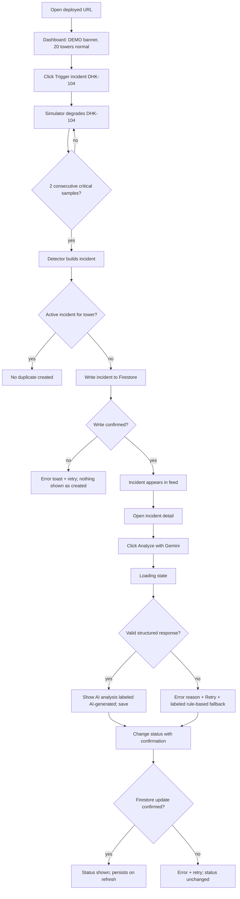

# AppFlow — Application Flow

Nothing here is implemented yet. Pages marked P1/P2 are hidden from navigation until built (no dead links).

## 1. Entry points
- Deployed Firebase Hosting URL → Dashboard (`/`).
- Deep links (`/incidents/:incidentId`, `/sites/:towerId`) must work on refresh (Hosting single-page rewrite).
- **No login.** There is no sign-in screen (PO decision D-01). A persistent DEMO / SIMULATED banner replaces the "Login / Demo Access" page of the old rulebook.

## 2. Navigation map
| Route | Page | Pri |
|---|---|---|
| `/` | Dashboard | P0 |
| `/incidents` | Incident list | P0 |
| `/incidents/:incidentId` | Incident detail + Gemini analysis + status | P0 |
| `/sites`, `/sites/:towerId` | Network Sites + tower detail | P1 |
| `/analytics` | Network Analytics charts | P1 |
| `/ingestion` | Simulator controls (P0 controls live on Dashboard) + CSV/JSON upload | P1 |
| `/copilot` | AI Copilot | P1 |
| `/reports` | Reports | P2 |

Header: product name, DEMO/SIMULATED badge, nav links (only built pages), Judge Mode toggle (P2 only).

## 3. Golden Path sequence (identical to `docs/PRD.md` §9)
1. GP-1 Open URL → Dashboard with banner, 20 towers normal, live metrics.
2. GP-2 Click **Trigger incident (DHK-104)**.
3. GP-3 Within ~15 s a critical incident appears in the feed.
4. GP-4 Open incident → triggering metrics vs baseline.
5. GP-5 **Analyze with Gemini** → structured result.
6. GP-6 Status → Investigating → Resolved; persists after refresh.

## 4. Screen-by-screen journey
**Dashboard (P0).** Sections: banner; "Try it" 4-step card (Trigger → watch feed → open incident → analyze); simulator control panel (Start/Stop, Normal/Incident mode, Trigger incident); health summary (total, healthy, degraded, critical); live metrics (network averages, worst tower); tower health grid (20 tiles, status icon + label + color); incident feed (latest, severity, status, tower, time).
**Incident list (P0).** Table: ID, tower, severity, status, detected time, AI-analyzed yes/no, data origin. Filter by status. Default shows current demo session; toggle "Show all sessions".
**Incident detail (P0).** Header (ID, tower, severity, status, SIMULATED tag); Evidence panel (triggering metrics vs thresholds and baseline, last 12 samples); AI analysis panel; status control; status history.
**Sites / tower detail (P1).** List with health; detail with current metrics and mini charts.
**Analytics (P1).** Tower selector + metric charts.
**Ingestion (P1).** Simulator controls (mirrors dashboard) and upload with validation results table.
**Copilot (P1).** Question box, example questions, answer with facts/data-used/uncertainty sections.
**Reports (P2).** Period selector, generate, display, copy.

## 5. Decision points and alternate paths
- Incident already active for tower → no duplicate; UI shows existing incident.
- Gemini unavailable → fallback (§7).
- User clicks Analyze twice → second click ignored while in flight.
- Firestore unreachable → incidents shown from in-memory session with banner "Not saved"; status changes disabled (no false success).
- Page refresh mid-incident → simulator restarts in Normal mode; stored incidents reload from Firestore.

## 6. Form and action flows
| Action | Flow |
|---|---|
| Trigger incident | Click → button disabled → mode label "Incident mode: DHK-104" → auto-ends after ~90 s |
| Analyze | Click → disable button, show spinner + "up to 30 s" → success/failure state |
| Change status | Select next status → confirm dialog (states what changes) → write → success only after confirmed |
| Upload (P1) | Pick file → type/size check → parse → per-row validation → summary (accepted/rejected + reasons) → process accepted rows |
| Copilot question (P1) | Enter (≤ 500 chars) → intent step → validated operation → trusted data fetch → answer step |

## 7. Loading / empty / success / error states
| Screen | Loading | Empty | Success | Error |
|---|---|---|---|---|
| Dashboard | Skeleton tiles first 2 s | "Waiting for first samples" | Live tiles | "Simulator stopped" with Start |
| Incident feed | Skeleton | "No incidents. Trigger one to try the demo." | New row highlighted | "Can't load incidents" + Retry |
| AI analysis | Spinner + elapsed time | "Not analyzed yet" + button | Structured panel with AI label | Reason (timeout / quota / network / invalid response) + Retry + **rule-based fallback** labeled "Not AI" |
| Status change | Button spinner | — | Status badge updates after confirmation | Error + retry; status unchanged |

## 8. Retry and recovery
Transient errors (network, 5xx, timeout): one automatic retry after 2 s, then manual Retry. Quota (429): no auto-retry; show wait message. Invalid response: one automatic re-ask, then fallback. Inputs (question text, uploaded file name) are preserved after recoverable errors.

## 9. Authentication flow
**Not applicable.** No registration, sign-in, verification, password reset, MFA, sessions, roles, or protected routes (PO decision D-01). Optional invisible anonymous sign-in is decision D-04, pending approval; it would add no user-facing screens.

## 10. Judge Mode flow (P2; see `docs/Judge_Mode.md`)
Toggle → guided overlay steps matching GP-1…GP-6 → reset creates a new demo session ID (old incidents hidden, not deleted).
